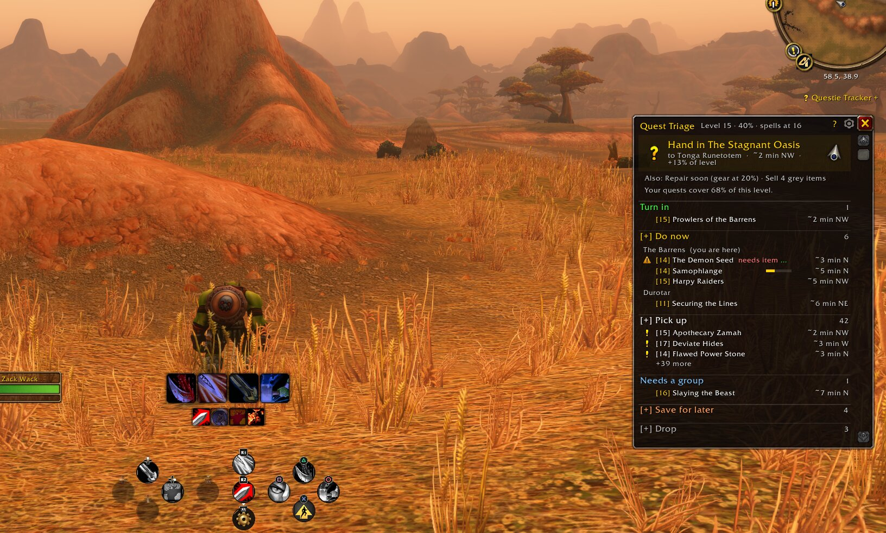
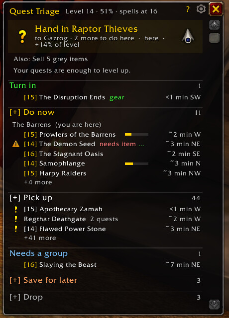
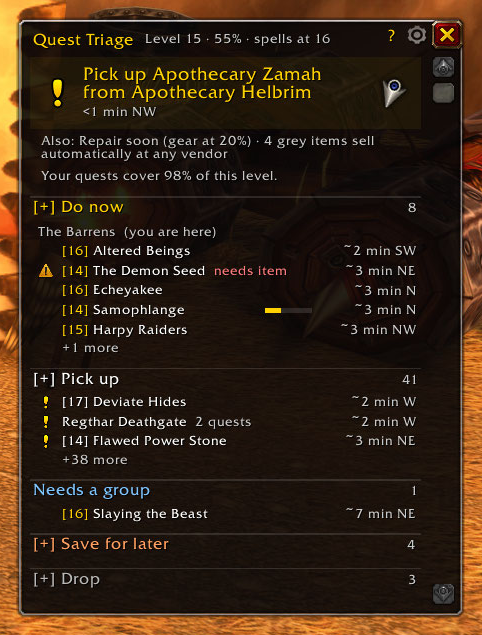
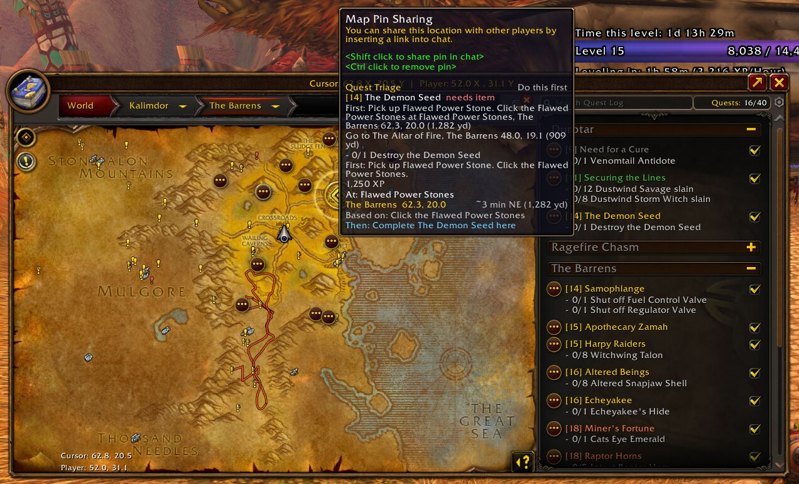
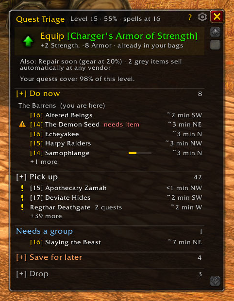
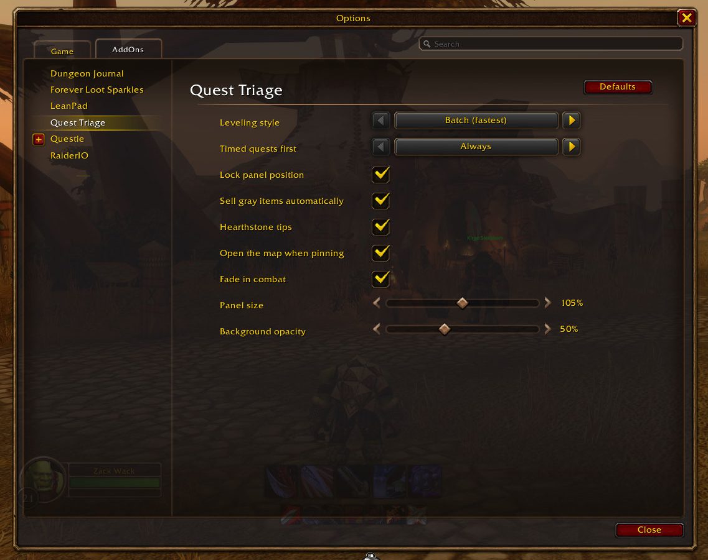

**Quest Triage is a leveling guide and quest helper for WoW: Forever that tells you the single best thing to do next.** It reads your quest log, bags, gear and position, then points a live arrow at your next quest, hand-in or pick-up. No route to memorize and no guide to read: one card says what to do now.

Works with **Questie**: directions, nearby quest givers and monster spawn areas come from your Questie install.

## Leveling guide that adapts to you

- **One clear next step.** Hand in, pick up, go do, or fix something first, chosen for where you're standing right now.
- **Live waypoint arrow and travel time** ("~2 min NW"), plus a map pin with a full tooltip.
- **Objective checklist** on the card: see what's done and what's left at a glance.
- **Batch or one at a time.** Clear every quest in a hub before you leave and do nearby objectives in one trip, or finish, hand in, then pick up the next.
- **Stays on track.** It sticks with the quest you're doing and finishes what you started instead of jumping around.
- **Timed quests first.** Need for a Cure and other quests with a timer jump to the top, with the minutes left. Prefer them only near the end, or never? It's a setting.

*Clear a hub before you leave: Batch mode walks you through every hand-in and pick-up nearby first.*

## Quest helper: your quest log, sorted

**Turn in · Do now · Pick up · Needs a group · Save for later · Drop**, each with a one-line reason. Hover any line for the objectives, the reason and the exact location; click to pin it on your map.

- **Quest items in your bags**: an item that starts a quest you don't have yet becomes the next step, "Open" it.
- **Nearby quests you haven't picked up yet**, worth doing at your level, nearest first. Event quests (Darkmoon Faire and holidays) are listed with the event's name but never pull you off your route. Talk to a quest giver and it checks what they really offer you: a follow-up you can't take yet drops off the list until you can.
- **Save for later** shows the level to come back at; **Drop** flags grey and failed quests.
- **Knows the game's quest areas**: it points where Blizzard itself marks the quest on your map, and inside the white boundary on your minimap it says "do it here".
- **Catches blocked quests**: needs an item first? It says where and how to get it, with two map markers.
- **Real hunting grounds**, not a lone spawn at the edge of the map; if kills are slow, it suggests a denser spot.

*Never miss a quest: nearby quest givers worth your time, nearest first.*

*Map pins that explain themselves: the step, what you need first and how to get it, exact coordinates and distance, and where to go after.*

## Level faster and get stronger

- **Gear upgrades** from quest rewards and your bags, judged on real stats for your class (never cloth for a Warrior). One click to equip. A two-hander has to beat your weapon and shield together, and right-click stops an item you don't want.
- **Trainer spells** read from your spellbook: it tells you when new spells unlock, so no wasted trips.
- **Learns from your deaths**: die twice on the same quest and it moves to Save for later.
- **Death handling**: release, run back with the arrow, resurrect, carry on.
- **Nearest repair vendor** when your gear drops below 25%: click to pin it.
- **Hearthstone tip**: in a town far from where your hearthstone is set, it suggests making that inn your home, so your hearthstone brings you back to where you're questing. Right-click to skip an inn, or turn it off in settings.
- **Fight check**: target a monster and see if it's risky (level, elite, rare).
- **Auto-sell grey items** at any vendor.

*Upgrades judged on real stats for your class, with the exact trade shown.*

## Easy to read

Readable colors (7:1 contrast), every line one row, details on hover, adjustable size and background opacity (see-through text gets a dark outline, so it stays readable over anything), and it fades in combat so it never blocks the fight.

*Simple settings in the game's own Options window: Batch or one at a time, when timed quests go first, auto-sell greys, opening the map when you pin, lock, size, background opacity, combat fade.*

## How to use

The panel opens on login. Everything is in the Next card and the lists; hover any line for details.

- **Click a line:** map pin there, and the map opens.
- **Shift-click a quest:** link it in chat.
- **Right-click a line:** show on map, open in quest log, share with party, save for later (until a level you pick, or until you bring it back), hide, abandon (Drop list), try again.
- **Click an Equip step:** puts the item on.

| Command | What it does |
| --- | --- |
| `/qt` | Show or hide the panel |
| `/qt options` | Open the settings |
| `/qt stats` | Your leveling stats |
| `/qt unhide` | Bring back hidden quests and items |
| `/qt reset` | Move the panel back to its starting spot |
| `/qt debug` | Details for a bug report, ready to copy |

## FAQ

**Does it work without Questie?**
Yes. It still sorts your quest log and checks gear, trainers, deaths and quest areas. Directions, nearby pick-ups and spawn areas need [Questie](https://www.curseforge.com/wow/addons/questie).

**Which game versions are supported?**
WoW: Forever. Other versions aren't tested yet.

**Is it a step-by-step leveling route?**
No fixed route. It works out the best next step from your own quest log and position, so it fits however you play.

**Does it collect any data?**
No. Everything stays in your own SavedVariables; nothing is sent anywhere.

**Where do I report bugs?**
On GitHub: https://github.com/tamuir/QuestTriage/issues. Type `/qt debug`: a window opens with the details already selected. Press Ctrl+C and paste them into your report; that helps a lot.

## Credits

Where to do your quests comes from the game's own quest markers whenever it has them. Quests to pick up, turn-in NPCs, missing items and hunting spots come from [Questie](https://github.com/Questie/Questie) and QuestieDB, read at runtime from your own install; Quest Triage contains none of their code or data. Map pins and distances use [HereBeDragons](https://github.com/Nevcairiel/HereBeDragons) by Nevcairiel (BSD), bundled unmodified with LibStub and CallbackHandler from Ace3 (see [Libs/LICENSES.md](https://github.com/tamuir/QuestTriage/blob/main/Libs/LICENSES.md)). Thank you to the Questie team and contributors, to Nevcairiel and to the Ace3 team. Open source under [GPL-3.0](https://github.com/tamuir/QuestTriage/blob/main/LICENSE.md).
