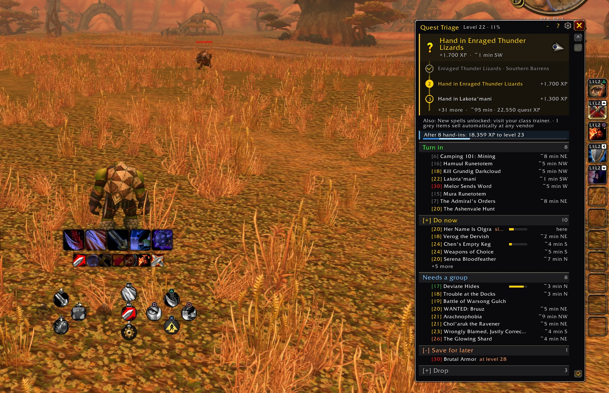
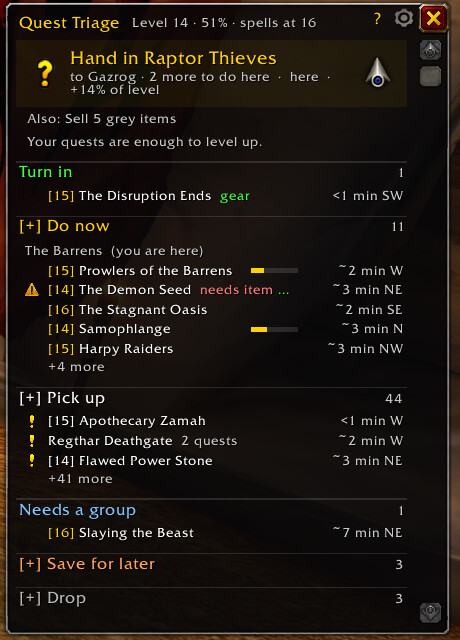
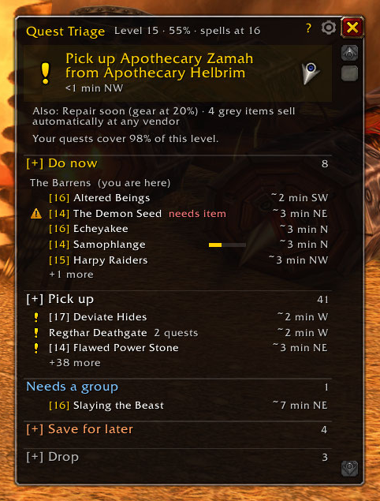
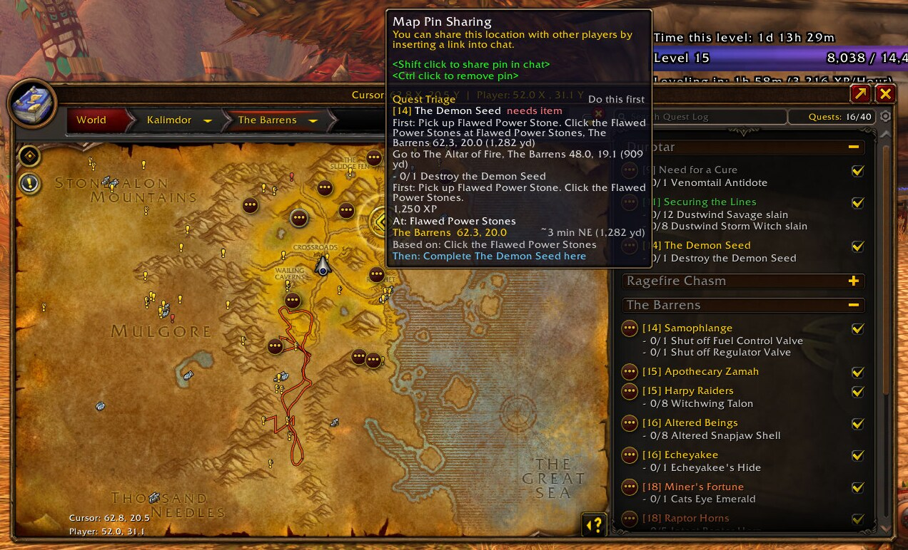
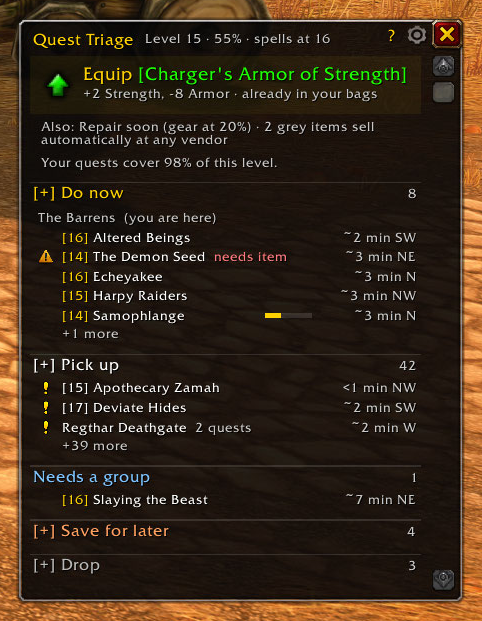

**Quest Triage is a leveling guide and quest helper for WoW: Forever that tells you the single best thing to do next.** It reads your quest log, bags, gear and position, then points a live arrow at your next quest, hand-in or pick-up. No route to memorize and no guide to read: one card says what to do now.

Works with **Questie**: nearby quest givers, turn-in NPCs and monster spawn areas come from your Questie install. In English and German.

## Leveling guide that adapts to you

**Power Leveling** starts automatically and compares trips from your current position. It includes 970 quests from levels 1–60 and can start with an empty log. Near the next level it compares ready hand-ins with nearby work that covers the XP gap. The compact panel shows your next action, estimated time to level and the XP left after the current hand-in. Expand it with **+** and the route hangs off the Next card as a numbered timeline: the stop you just finished (checked once the game confirms it), the one you're on and the next, with the XP each hand-in pays and the time to level. Click the footer for ten stops at a time and scroll with the mouse wheel; hover a stop for its NPC, coordinates and every step. It updates as you move, earn XP and finish quests.

*The route at a glance: done, now and next, numbered, with the XP each stop pays.*

- **One clear next step.** Hand in, pick up, go do, or fix something first, chosen for where you're standing right now.
- **Live waypoint arrow and travel time** ("~2 min NW"), plus a map pin with a full tooltip.
- **Objective checklist** on the card: see what's done and what's left at a glance.
- **Three leveling styles.** Power Leveling (default) plans whole trips; Batch clears every quest in a hub before you leave and does nearby objectives in one trip; One at a time finishes, hands in, then picks up the next.
- **Stays on track.** It sticks with the quest you're doing and finishes what you started instead of jumping around.
- **Timed quests first.** Need for a Cure and other quests with a timer jump to the top, with the minutes left. Prefer them only near the end, or never? It's a setting.

*Clear a hub before you leave: Batch mode walks you through every hand-in and pick-up nearby first.*

## Quest helper: your quest log, sorted

**Turn in · Do now · Pick up · Needs a group · Save for later · Drop**, each with a one-line reason. Hover any line for the objectives, the reason and the exact location; click to pin it on your map.

- **Quest items in your bags**: an item that starts a quest you don't have yet becomes the next step, "Open" it.
- **Nearby quests you haven't picked up yet**, worth doing at your level, nearest first, from givers within a few minutes' walk. Don't want one, or your friends already did it? Right-click and skip it. Event quests (Darkmoon Faire and holidays) are listed with the event's name but never pull you off your route. Talk to a quest giver and it checks what they really offer you: a follow-up you can't take yet drops off the list until you can.
- **Save for later** shows the level to come back at; **Drop** flags grey and failed quests.
- **Knows the game's quest areas**: it points where Blizzard itself marks the quest on your map, and inside the white boundary on your minimap it says "do it here".
- **Catches blocked quests**: needs an item first? It says where and how to get it, with two map markers.
- **Real hunting grounds**, not a lone spawn at the edge of the map; if kills are slow, it suggests a denser spot.

*Never miss a quest: nearby quest givers worth your time, nearest first.*

*Map pins that explain themselves: the step, what you need first and how to get it, exact coordinates and distance, and where to go after.*

## Level faster and get stronger

- **Gear upgrades** from quest rewards and your bags, judged on real stats for your class (never cloth for a Warrior). One click to equip. A two-hander has to beat your weapon and shield together, and right-click stops an item you don't want.
- **Trainer spells** read from your spellbook: it tells you when new spells unlock, so no wasted trips.
- **Learns from your deaths**: die twice on the same quest and it moves to Save for later.
- **Death handling**: release, run back with the arrow, resurrect, carry on.
- **Nearest repair vendor** when your gear drops below 25%: click to pin it.
- **Hearthstone tip**: in a town far from where your hearthstone is set, it suggests making that inn your home, so your hearthstone brings you back to where you're questing (not in a city your mage can teleport to). Right-click to skip an inn, or turn it off in settings.
- **Fight check**: target a monster and see if it's risky (level, elite, rare).
- **Auto-sell grey items** at any vendor.

*Upgrades judged on real stats for your class, with the exact trade shown.*

## Easy to read

Readable colors (7:1 contrast), every line one row, details on hover, adjustable size and background opacity (see-through text gets a dark outline, so it stays readable over anything), and it fades in combat so it never blocks the fight.

*Simple settings in the game's own Options window: Power Leveling, Batch or one at a time, when timed quests go first, compact panel and its stat, auto-sell greys, opening the map when you pin, lock, size, background opacity, combat fade.*

## How to use

The panel opens on login. Everything is in the Next card and the lists; hover any line for details.

- **Click a line:** map pin there, and the map opens.
- **Shift-click a quest:** link it in chat.
- **Right-click a line:** show on map, open in quest log, share with party, save for later (until a level you pick, or until you bring it back), hide, skip a quest to pick up, abandon (Drop list), try again.
- **Click an Equip step:** puts the item on.
- **+** shows the route and quest lists. **−** folds the panel to the Next card.
- **Route footer:** click for ten stops at a time (mouse wheel scrolls them), click again for done, now and next.
- **Closed it?** Bring it back from the minimap's addon menu (right-click there for the settings), with `/qt`, or with a key.
- **Keys** (Options > Keybindings > AddOns): show or hide the panel, and go to the next step (same as clicking the card).
- **At the reward window** it names the choice that's a clear upgrade for you, in chat. The pick stays yours.

| Command | What it does |
| --- | --- |
| `/qt` | Show or hide the panel |
| `/qt options` | Open the settings |
| `/qt power` | Enable Power Leveling |
| `/qt route` | Show each stop, its quest rewards and the XP left to level |
| `/qt route bands` | Browse catalog zones for your race and faction by level band |
| `/qt route 21` | Preview up to three trips for that level from your current position |
| `/qt party on` or `/qt party off` | Toggle party route coordination on this character |
| `/qt stats` | Your leveling stats |
| `/qt unhide` | Bring back hidden and skipped quests and items |
| `/qt reset` | Move the panel back to its starting spot |
| `/qt debug` | Details for a bug report, ready to copy |

## FAQ

**Does it work without Questie?**
Yes. The bundled catalog supplies pickups, objectives and hand-ins. The game supplies your quest log and its map markers. Questie adds offer checks, more quests, item sources and spawn areas. [Questie on CurseForge](https://www.curseforge.com/wow/addons/questie)

**Which languages?**
English and German. Anything not translated yet shows in English.

**Which game versions are supported?**
WoW: Forever. Other versions aren't tested yet.

**Is it a step-by-step leveling route?**
Power Leveling plans trips from your position, quest progress and available travel. It checks the next objective and hand-in as well as the pickup. Learn a suggested flight path by speaking to the flight master. The planner can use that flight once the game confirms the connection and fare.

**Does it collect any data?**
Leveling history and flight measurements stay in your character's SavedVariables. If you enable party coordination, the addon sends your current quest ID, remaining credits and affordable flight connections to your party through the game's addon channel.

**Where do I report bugs?**
On GitHub: https://github.com/tamuir/QuestTriage/issues. Type `/qt debug`: a window opens with the details already selected. Press Ctrl+C and paste them into your report; that helps a lot.

## Credits

The planner uses Forever quest facts from QuestieDB, travel facts from Polestar and its upstream contributors, and native game observations. Map pins and coordinate conversion use HereBeDragons by Nevcairiel with LibStub and CallbackHandler from Ace3. [Resource review](https://github.com/tamuir/QuestTriage/blob/main/docs/power-leveling.md) · [Bundled credits](https://github.com/tamuir/QuestTriage/blob/main/Libs/LICENSES.md) · [GPL-3.0](https://github.com/tamuir/QuestTriage/blob/main/LICENSE.md)
