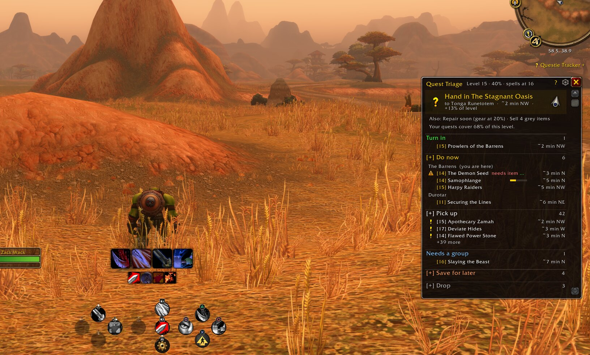
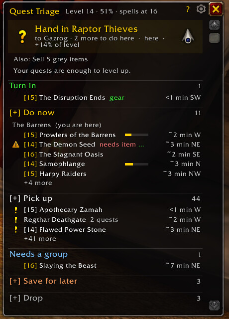
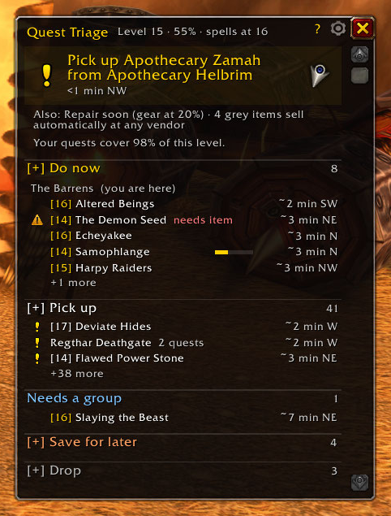
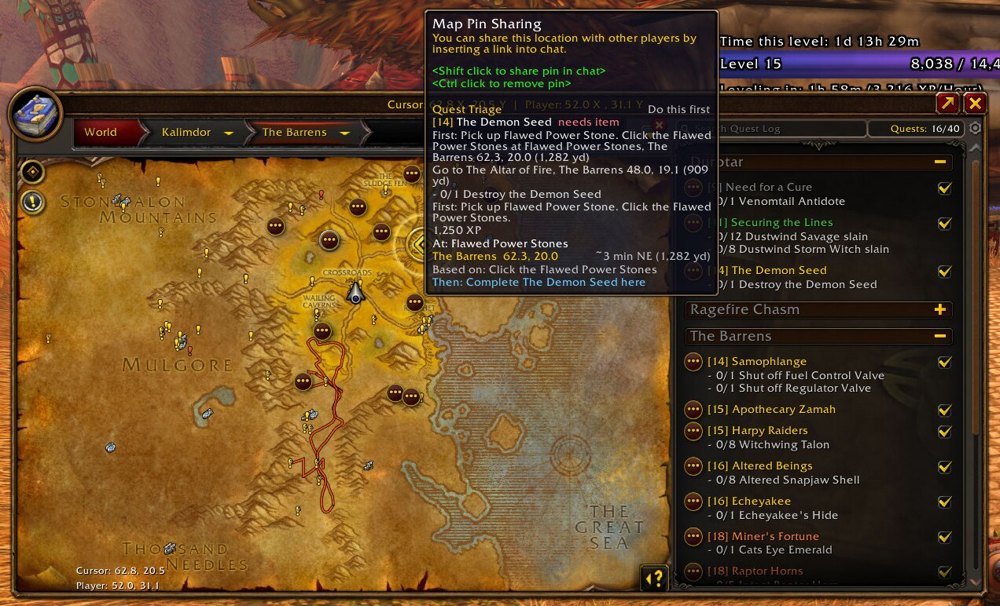
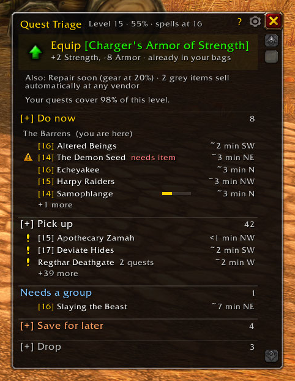
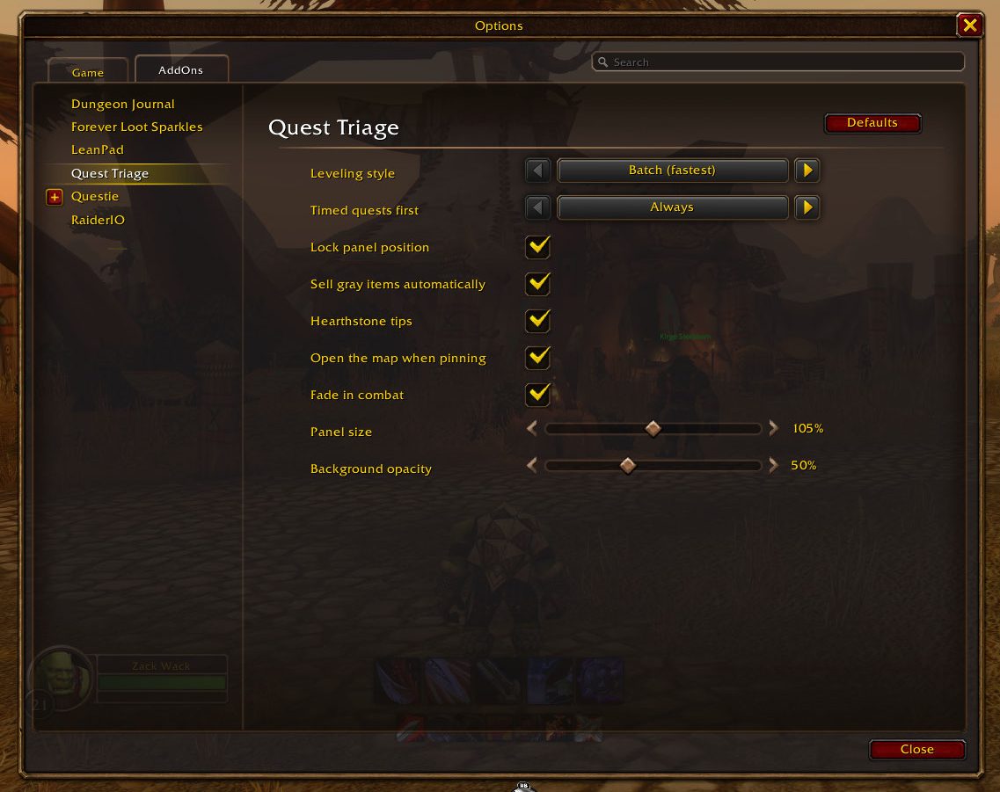

# Publishing Quest Triage on CurseForge

Everything for the CurseForge project page, in the order the form asks for it, written so players searching for a
leveling addon or quest helper find it. Search on CurseForge and Google weighs, in order: the **name**, the
**summary**, the **first lines of the description**, the **categories**, then the rest of the description and image
captions. Each field below puts the words players actually search for ("leveling", "quest helper", "guide",
"WoW Forever", "Questie", "arrow", "gear upgrade") where they count, without keyword stuffing.

## 1. Project fields

| Field | Value | Why |
| --- | --- | --- |
| Name | **Quest Triage - Leveling Guide & Quest Helper** | The brand plus the two phrases people search for. 44 characters, so it isn't cut off in search results. |
| Project URL (slug) | `quest-triage` | Short and readable. It can't easily be changed later. |
| Summary | **Leveling guide and quest helper for WoW Forever: your best next quest with a live arrow, nearby quests, gear upgrades and what to skip.** | Keywords first; 136 characters, so the whole line shows in search snippets. |
| Main category | Quests & Leveling | Where leveling players browse. |
| Extra categories | Map & Minimap · Bags & Inventory | Map pins and arrow; auto-sell grays and gear upgrades. Only add categories that honestly fit. |
| Game version | WoW Forever (the `.toc` says `## Interface: 16001`) | Only claim what's tested. |
| License | GNU General Public License version 3 (GPLv3) | Matches `LICENSE.md`. |
| Logo | `media/logo-400.png` (400 x 400) | Bright gold on dark reads well at thumbnail size. |
| Source | https://github.com/tamuir/QuestTriage | A visible source link builds trust. |
| Issues | https://github.com/tamuir/QuestTriage/issues | Bug reports go to GitHub. |
| Relations | Questie: **Optional dependency** | Shows on Questie's "dependents" list too, which brings in Questie users. |

## 2. Description (paste into the description editor, Markdown mode)

The first two sentences are what Google and CurseForge show as the preview, so they carry the main keywords.
Headings use the phrases players search for. Keep the FAQ: question-style headings match how people type searches.

This text is made from `README.md`, so the two always match (images load from GitHub). After changing the README, run `sh tools/curseforge-description.sh --update` to refresh it here, then paste it again.

<!-- curseforge-description:start -->
```markdown
**Quest Triage is a leveling guide and quest helper for WoW: Forever that tells you the single best thing to do next.** It reads your quest log, bags, gear and position, then points a live arrow at your next quest, hand-in or pick-up. No route to memorize and no guide to read: one card says what to do now.

Works with **Questie**: directions, nearby quest givers and monster spawn areas come from your Questie install.



## Leveling guide that adapts to you

- **One clear next step.** Hand in, pick up, go do, or fix something first, chosen for where you're standing right now.
- **Live waypoint arrow and travel time** ("~2 min NW"), plus a map pin with a full tooltip.
- **Objective checklist** on the card: see what's done and what's left at a glance.
- **Batch or one at a time.** Clear every quest in a hub before you leave and do nearby objectives in one trip, or finish, hand in, then pick up the next.
- **Stays on track.** It sticks with the quest you're doing and finishes what you started instead of jumping around.



*Clear a hub before you leave: Batch mode walks you through every hand-in and pick-up nearby first.*

## Quest helper: your quest log, sorted

**Turn in · Do now · Pick up · Needs a group · Save for later · Drop**, each with a one-line reason. Hover any line for the objectives, the reason and the exact location; click to pin it on your map.

- **Quest items in your bags**: an item that starts a quest you don't have yet becomes the next step, "Open" it.
- **Nearby quests you haven't picked up yet**, worth doing at your level, nearest first. Talk to a quest giver and it checks what they really offer you: a follow-up you can't take yet drops off the list until you can.
- **Save for later** shows the level to come back at; **Drop** flags grey and failed quests.
- **Knows the game's quest areas**: inside the white boundary on your minimap it says "do it here".
- **Catches blocked quests**: needs an item first? It says where and how to get it, with two map markers.
- **Real hunting grounds**, not a lone spawn at the edge of the map; if kills are slow, it suggests a denser spot.



*Never miss a quest: nearby quest givers worth your time, nearest first.*



*Map pins that explain themselves: the step, what you need first and how to get it, exact coordinates and distance, and where to go after.*

## Level faster and get stronger

- **Gear upgrades** from quest rewards and your bags, judged on real stats for your class (never cloth for a Warrior). One click to equip.
- **Trainer spells** read from your spellbook: it tells you when new spells unlock, so no wasted trips.
- **Learns from your deaths**: die twice on the same quest and it moves to Save for later.
- **Death handling**: release, run back with the arrow, resurrect, carry on.
- **Nearest repair vendor** when your gear drops below 25%: click to pin it.
- **Hearthstone tip**: in a town far from where your hearthstone is set, it suggests making that inn your home, so your hearthstone brings you back to where you're questing. Right-click to skip an inn, or turn it off in settings.
- **Fight check**: target a monster and see if it's risky (level, elite, rare).
- **Auto-sell grey items** at any vendor.



*Upgrades judged on real stats for your class, with the exact trade shown.*

## Easy to read

Readable colors (7:1 contrast), every line one row, details on hover, adjustable size, and it fades in combat so it never blocks the fight.



*Simple settings in the game's own Options window: Batch or one at a time, auto-sell greys, lock, size, combat fade.*

## How to use

The panel opens on login. Everything is in the Next card and the lists; hover any line for details.

- **Click a line:** map pin there, and the map opens.
- **Shift-click a quest:** link it in chat.
- **Right-click a line:** show on map, open in quest log, share with party, save for later (until a level you pick, or until you bring it back), hide, abandon (Drop list), try again.
- **Click an Equip step:** puts the item on.

Commands: `/qt` show or hide · `/qt options` settings · `/qt stats` your leveling stats · `/qt unhide` bring back hidden quests · `/qt reset` move the panel back · `/qt debug` explain every pin (for bug reports)

## FAQ

**Does it work without Questie?**
Yes. It still sorts your quest log and checks gear, trainers, deaths and quest areas. Directions, nearby pick-ups and spawn areas need [Questie](https://www.curseforge.com/wow/addons/questie).

**Which game versions are supported?**
WoW: Forever. Other versions aren't tested yet.

**Is it a step-by-step leveling route?**
No fixed route. It works out the best next step from your own quest log and position, so it fits however you play.

**Does it collect any data?**
No. Everything stays in your own SavedVariables; nothing is sent anywhere.

**Where do I report bugs?**
On GitHub: https://github.com/tamuir/QuestTriage/issues. Running `/qt debug` and attaching the output helps a lot.

## Credits

Directions and quest data come from [Questie](https://github.com/Questie/Questie) and QuestieDB, read at runtime from your own install; Quest Triage contains none of their code or data. Map positions use Questie's copy of HereBeDragons. Thank you to the Questie team and contributors. Open source under [GPL-3.0](https://github.com/tamuir/QuestTriage/blob/main/LICENSE.md).
```
<!-- curseforge-description:end -->

### Image titles and descriptions

CurseForge lets you give every gallery image a title and description; both are indexed. Use these:

| File | Title | Description |
| --- | --- | --- |
| `next-step.jpg` | Leveling guide: your next quest with a live arrow | The Next card shows where to go, how far and how much XP it's worth. |
| `batch-hub.jpg` | Quest helper: clear a hub before you leave | Batch mode walks you through every hand-in and pick-up nearby first. |
| `pick-up.png` | Quest helper: never miss a quest nearby | Nearby quest givers worth your time, nearest first, with the next one on the card. |
| `pin-tooltip.jpg` | Map pins that explain themselves | Hover the pin for the step, what you need first, coordinates and distance, and where to go after. |
| `gear.png` | Gear upgrades for your class | Upgrades judged on real stats, one click to equip. |
| `settings.png` | Settings: batch or one at a time | Leveling style, auto-sell greys, size and combat fade. |

Set `next-step.jpg` as the **featured image**: it explains the addon in one look.

### After launch

- Post a short changelog with every release (the release workflow uploads `CHANGELOG.md` automatically); regular updates rank higher.
- Reply to comments; activity counts.
- Link the CurseForge page from the GitHub README once it exists.

## 3. Gallery images

Upload these from `docs/images/`, with the titles and descriptions from the table in section 2. Make `next-step.jpg`
the featured image.

`next-step.jpg` · `batch-hub.jpg` · `pick-up.png` · `pin-tooltip.jpg` · `gear.png` · `settings.png`

## 4. Automatic uploads (one-time setup)

1. Create the project on CurseForge with the fields above and note its **Project ID** (shown on the project page).
2. In `QuestTriage.toc`, replace the commented line with `## X-Curse-Project-ID: <your id>`.
3. On CurseForge, create an **API token** (your account settings, API tokens).
4. On GitHub, repo Settings > Secrets and variables > Actions, add a secret named `CF_API_KEY` with that token.
5. Commit and push step 2. From then on, **releasing is one step**: add a dated section to the top of `CHANGELOG.md`,
   such as `## [0.5.1] - 2026-11-10`, and push to main. GitHub runs the tests, tags `v0.5.1`, builds the zip (only what
   the game loads) and uploads it to GitHub Releases and CurseForge for WoW: Forever. The version in the `.toc` is
   stamped automatically.

The first release (0.5.0) is already in the changelog, so it goes out as soon as steps 1 to 4 are done: after pushing
the project ID, open GitHub > Actions > Release > **Run workflow**.

If CurseForge doesn't list WoW: Forever (game version 1.60.1), the release stops before publishing anything and says so.

## 5. Before you publish

- [ ] Play a session on the release build; run `/qt debug` once to check pins.
- [ ] Gallery images uploaded (section 3).
- [ ] Project ID in the `.toc`, `CF_API_KEY` secret set.
- [ ] Questie listed as an optional dependency on the project page.
