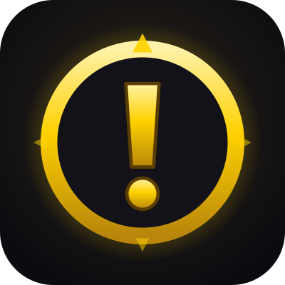

# Quest Triage

**Your leveling co-pilot for World of Warcraft: Forever.** Quest Triage looks at your quest log, your bags, your gear and where you're standing, and tells you the single best thing to do next, with an arrow pointing the way.

No guide to read, no route to memorize. One card at the top of the panel says what to do now.

## What it does

- **One clear next step.** The Next card picks the best move right now: hand in, pick up, go do, or fix something first. A live arrow turns with you, and travel time is shown ("~2 min NW").
- **Your quest log, sorted.** Turn in · Do now · Pick up · Needs a group · Save for later (with the level to come back at) · Drop, each with a one-line reason in the tooltip.
- **Quests you haven't picked up yet.** Nearby quest givers worth your time, nearest first (needs Questie).
- **Batch or one at a time.** Batch mode grabs every quest near you before you leave a hub and groups quests whose objectives are close together into one trip. One-at-a-time finishes, hands in, then picks up the next.
- **Knows the game's quest areas.** Standing inside a quest's area (the white boundary on the minimap)? It says "do it here", and combines overlapping quests into one step.
- **Catches what blocks you.** A quest that needs an item first says where to get it and how ("Click the Flawed Power Stone"), with two map markers: get the item, then complete the quest.
- **Real hunting grounds.** Points to dense spawn areas, not a stray spawn at the edge of the map. If kills are slow, it suggests a denser spot.
- **Gets you stronger.** Gear upgrades from quest rewards and your bags, judged on real stats for your class (never cloth for a Warrior). Click to equip. New trainer spells, read from your spellbook, so no wasted trips.
- **Learns from your deaths.** Die twice on the same quest at the same level and it moves to "Save for later: come back at 16".
- **Death handling.** Release, run back to your corpse with the arrow, resurrect; your route resumes where you left off.
- **Fight check.** Target a monster out of combat and see if it's risky for you (level, elite, rare).
- **Small conveniences.** Auto-sells gray items at vendors, map pins with a full tooltip, combat fade, readable colors (7:1 contrast).

## Requirements

- **World of Warcraft: Forever.**
- **[Questie](https://www.curseforge.com/wow/addons/questie)** (recommended). Directions, pick-ups, item sources and hunting areas come from Questie's database. Without it, Quest Triage still sorts your quest log, checks gear, trainers, deaths and quest areas, but can't give directions.

## How to use

The panel opens on login. Everything is in the Next card and the lists; hover any line for details.

| Action | What happens |
| --- | --- |
| Click a line | Map pin there, map opens |
| Shift-click a quest | Link it in chat |
| Right-click a line | Show on map, open in quest log, hide, abandon (Drop list), try again |
| Click the Next card's equip step | Puts the item on |

Slash commands:

| Command | |
| --- | --- |
| `/qt` | Show or hide the panel |
| `/qt options` | Settings: leveling style, auto-sell grays, lock, size, combat fade |
| `/qt stats` | How you're doing: quests done, time per quest, advice followed |
| `/qt unhide` | Bring back quests you hid |
| `/qt reset` | Move the panel back to its default spot |
| `/qt debug` | Explain every pin and arrow (for bug reports) |

## Privacy

Everything stays on your computer, in your SavedVariables. Quest Triage sends nothing anywhere.

## Development

- Code: `Core.lua` (decisions, no game API, fully tested), `Api.lua` (reads the game), `Guide.lua` (Questie data and map pins), `UI.lua` (panel, events, options).
- Tests: `sh run-tests.sh` syntax-checks every file and runs `tests.lua` under Lua 5.1 in Docker.
- Releases: push a tag like `v0.5.0`; GitHub Actions runs the tests, packages the addon and uploads it to CurseForge.

## Credits

- Directions, quest givers, spawn points and item sources come from **[Questie](https://github.com/Questie/Questie)** and **QuestieDB**, read at runtime from your own Questie install. Quest Triage contains none of their code or data. Thank you to the Questie team and contributors.
- Map positions use Questie's copy of **HereBeDragons**.

## License

[GPL-3.0](LICENSE.md)
